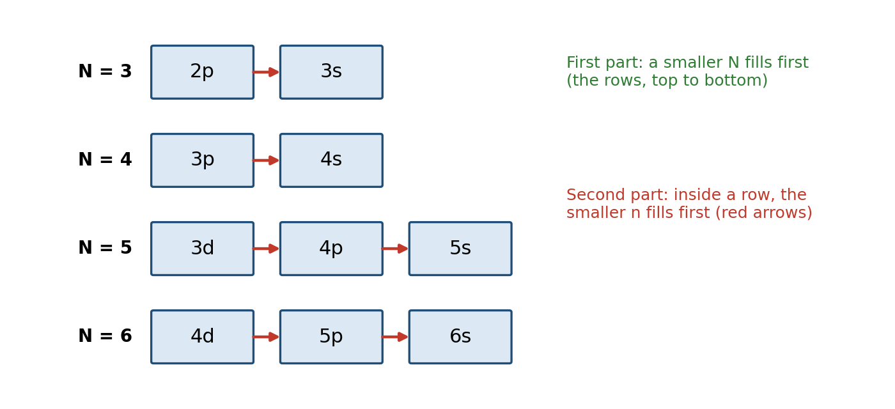
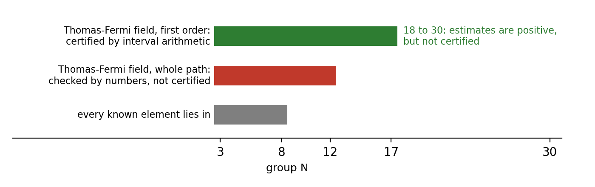

This is an introductory text to the research paper *A first-order Madelung tie-break on the round four-sphere: Kelvin parity, convex order and the Thomas-Fermi field* [Per26], by the same author. The paper has the proofs and the full computations. This note has the idea. No equations are needed to follow it. It makes no claim the paper does not make, and it says which claims are proved and which are only computed.

One caution comes first, because the paper itself puts it first. This is about a **model**. It shows why a neat piece of mathematics in a well-known model of the periodic table puts two levels in a certain order. It does not derive real atoms.

# A rule with two halves

Electrons in an atom sit in levels. Each level has two labels: a number $n = 1, 2, 3, \dots$ for the shell, and a letter for the shape of the orbit, $s, p, d, f$, which stand for $l = 0, 1, 2, 3$. The **Madelung rule** says how the levels fill up, and it has two halves.

- **First half.** Add the two labels, $N = n + l$. Levels with a smaller $N$ fill first. So $3p$ and $4s$ (both $N = 4$) fill before $3d$ ($N = 5$).
- **Second half.** When several levels share the same $N$, the one with the smaller $n$ fills first. In the row $N = 5$ the order is $3d$, then $4p$, then $5s$.

{width=78%}

The first half has an explanation inside a classical model. The second half is what this paper is about.

# What the model explains, and what it leaves open

In 1971 and 1972 the physicists Demkov and Ostrovsky built a model that reproduces the first half exactly [DO71, DO72]. An electron feels the pull of a nucleus whose strength is screened at a distance, with one particular shape of screening due to Tietz. The model looks at the situation at zero energy and asks how strong the pull must be for a solution to exist. The answers come in groups, and the groups are exactly the groups of equal $N$.

An earlier paper by the same author [Per26a] showed what this model really is: the standard vibration problem of a round sphere one dimension up, the **four-sphere**, which cannot be drawn but behaves like an ordinary sphere. The nucleus is one pole of that sphere, and the far-away point at infinity is the other. Turning space inside out around a certain radius, an old operation called the **Kelvin inversion**, becomes the mirror that swaps the two poles.

All of this explains why the levels of a group sit together. In the model, every level of a group needs exactly the same pull. They are **tied**. Nothing in the model says who goes first inside a tie. The second half of the rule was put in by hand. The question is simple: why should $3d$ come before $4p$, and $4p$ before $5s$?

# The idea of a gentle push

The natural idea is old, and goes back to Goudsmit and Richards [GR]. The model's field is not the field of a real atom. A real field is a bit different, and a small difference of the right kind lifts the tie, because the levels of the group react to it in different ways. The levels are spread out over the sphere in different ways, and a change of the field that is stronger in some region moves most the levels that spend more time there.

The paper makes this precise at first order, that is, for a push that is small. The picture is short. A level lives on the sphere with a certain **spread**: where, between the equator and the poles, the electron is likely to be found. For each level of the group the paper computes this spread exactly. A small change of the field that depends on the distance from the nucleus only then moves each level by an amount that depends only on that spread. So the tie breaks, and the order depends only on how the spreads compare.

{width=90%}

A field that is weaker than the Tietz field near the poles needs a larger pull to hold an electron, so it raises the levels that sit near the poles the most. Inside a group, the level with the largest $l$ (so the smallest $n$) has the least weight near the poles, and the level with the smallest $l$ has the most. The level with the least weight near the poles is raised least, so it is the first to be held, and that is the one with the smaller $n$. That is exactly the second half of the rule.

# Why a simple comparison is not enough

To compare two spreads, the first idea is to say that one level always sits closer to the equator than the other: within any given distance from the equator, it has at least as much weight. The paper checks this, and it **fails**. The two curves cross. It fails for at least one pair of levels in every group from $N = 4$ to $N = 16$, found by an exact computation in whole fractions, with the first failure at $N = 4$. The failures are small. The deepest dip is about $0.004$ for the pair of levels $5p$ and $6s$ of the row $N = 6$, and about $0.017$ for the pair $4d$ and $5p$.

{width=90%}

What does hold is a weaker order, named the **convex order**: the order that matters when the push depends on the position in a way that grows and bends upward. The paper proves it, and these are its main results, both **proved**. Theorem 1 proves the convex order for every pair of neighbouring blocks, and Theorem 2 for neighbouring levels inside a group, with an explicit formula from Gegenbauer polynomials, a family of classical functions that describes vibrations on spheres, and a classical inequality of Laguerre. The proofs are short in outline and take some pages in full, and an exact computer check agrees with them for every group up to $N = 30$.

# The tie-break theorem

With the convex order in hand, the main theorem follows. Take the Tietz field and change it a little, by a push that depends on the distance from the nucleus only. Only the part of the push that is the same on both poles matters: this is the **Kelvin parity**, the mirror that swaps the nucleus and infinity cancels the rest. If that part makes the field weaker towards the poles, and does so in a way that increases and bends upward, then in every group the levels split, **smaller $n$ first**, at first order. This is **proved** (Theorem 3).

The theorem is honest about its reach. It is a statement for a small push, near the Tietz field. How small the push has to be depends on the group $N$, and the paper gives no number for it, and no bound that is the same for all $N$.

# The Thomas-Fermi field

A natural real field to test is the **Thomas-Fermi** field, the classical statistical picture of the electrons of a heavy atom. Close to the poles it does not have the upward-bending shape that Theorem 3 needs. There is a tiny sliver, about a ten-millionth of the range, where it bends the wrong way, and the paper says clearly that Theorem 3 is therefore **not applied** to this field.

Instead, the paper does a direct computation. For the Thomas-Fermi field, relative to the nearest Tietz field (one fitted scale), it computes the first-order shifts of the levels of a group and compares them. With **interval arithmetic**, a way of computing in which every number is carried with a rigorous error band, it certifies that the order is smaller $n$ first in every group up to $N = 17$ (Corollary 4). The smallest certified margin is $0.00685$, at $N = 17$. Every known element lies in the groups with $N \le 8$. The result is robust, by estimate, for a range of the fitted scale between $0.40$ and $0.65$ for $N \le 8$. For $N$ from 18 to 30 the estimates are positive too, but they are not certified.

A second check goes beyond first order. It follows the levels step by step along the whole path from the Tietz field to the Thomas-Fermi field, for the groups up to $N = 12$, and finds no crossing inside a group (Proposition 5). This is **computed** in ordinary computer arithmetic, on a grid of steps, and it is not a proof. At the Thomas-Fermi end, the groups $N = 11$ and $N = 12$ already overlap each other, so the paper only claims the order inside a group, not between groups.

{width=85%}

# What was checked and how

The identities and closed forms of the proofs are verified in exact arithmetic for all groups up to $N = 30$. An independent rebuild from the explicit three-dimensional states of the model agrees for ninety pairs of levels. The certified numbers come from interval arithmetic, and each figure of the paper has a script behind it. The parts that rest on a numerical grid or on estimates are labelled so in the paper, and they are labelled so here.

# What this note does not claim

It does not derive real atoms. It does not derive the factor of two for the spin of the electron. It does not derive the order **between** groups: the paper says explicitly that only the order inside a group is claimed. Theorem 3 holds only for small pushes, near the Tietz field. The result for the Thomas-Fermi field is certified for $N \le 17$ and computed for $N \le 12$ along the path, and it is not a statement about all $N$. The Madelung rule is known to fail for very heavy atoms [BFHS25], and the paper's statements concern a one-electron model at low $N$ and say nothing about that limit.

The novelty claims are all of the form "to our knowledge, in the sources we could consult". Goudsmit and Richards argued the second half of the rule from a gradual transition between two limits, which is the qualitative form of this paper's statement, without a theorem. The paper names the other works that bear on the claim, and those whose full text it could not read.

# Where to go next

- The paper itself [Per26], with the proofs, the certificates and the scripts.
- The earlier paper that shows the model is the four-sphere [Per26a].
- The original model [DO71, DO72] and the idea of a transition between two limits [GR].

# References {-}

[BFHS25] A. Bjerg, S. Fournais, P. Hearnshaw and J. P. Solovej, *The angular momentum distribution of electrons in large atoms and its deviation from Madelung's rule*, 2025, [arXiv:2506.14227](https://arxiv.org/abs/2506.14227).

[DO71] Yu. N. Demkov and V. N. Ostrovsky, *Internal symmetry of the Maxwell "fish-eye" problem and the Fock group for the hydrogen atom*, Sov. Phys. JETP 33 (1971) 1083-1087.

[DO72] Yu. N. Demkov and V. N. Ostrovsky, *n+l filling rule in the periodic system and focusing potentials*, Sov. Phys. JETP 35 (1972) 66-69.

[GR] S. A. Goudsmit and P. I. Richards, *The order of electron shells in ionized atoms*, Proc. Natl. Acad. Sci. USA 51 (1964) 664-671, [doi:10.1073/pnas.51.4.664](https://doi.org/10.1073/pnas.51.4.664).

[Per26] M. Perreault, *A first-order Madelung tie-break on the round four-sphere: Kelvin parity, convex order and the Thomas-Fermi field*, 2026, Zenodo. [doi:10.5281/zenodo.24533673](https://doi.org/10.5281/zenodo.24533673).

[Per26a] M. Perreault, *The Demkov-Ostrovsky Madelung model as the circle-invariant conformal Laplacian of the round 4-sphere*, 2026, Zenodo. [doi:10.5281/zenodo.24522163](https://doi.org/10.5281/zenodo.24522163).

```{=latex}
\par\ifdim\dimexpr\pagegoal-\pagetotal\relax<15\baselineskip\ifdim\pagetotal>0pt\newpage\fi\fi
```

# Read the research paper {-}

```{=latex}
\raggedright
```

The full paper, with the proofs, is *A first-order Madelung tie-break on the round four-sphere: Kelvin parity, convex order and the Thomas-Fermi field*, by Michaël Perreault.

DOI: [doi:10.5281/zenodo.24533673](https://doi.org/10.5281/zenodo.24533673)
